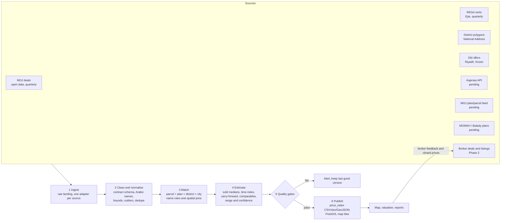

# 11 · Data pipeline flow

How Nyyf Pro turns every data source into one price table, and how new sources plug in.
Written 2026-10-30. Today's output is the final dataset in the project folder `nyyf-pro/base-data/final/`,
built by `data/pipelines/build_final.py` (see its README for the files). Sources and their limits are in
[10-data-sources.md](10-data-sources.md).

## Rules the pipeline keeps

1. **The most precise level wins, never an invented one.** A price is given per parcel, else plan (مخطط),
   else district, else city. A district centre is never drawn as if it were a parcel (`geo_precision`).
2. **Every number carries its basis, sources and confidence.** `price_basis`, `deals_basis`, `sources`,
   `confidence` and `confidence_reason` are on every row, so the map and valuations can say how sure they are.
3. **Raw data is kept as received.** Each run lands raw files untouched, then normalises a copy. Any number
   can be rebuilt from raw.
4. **One contract per kind of data.** Every deal source is mapped to the same deal schema before matching,
   so adding a source means writing one adapter, not changing the estimates.
5. **Publish only through quality gates.** A run that moves a city's median too far, drops coverage or
   loses rows stops before publishing.

## The flow



The same flow without Mermaid:

```
 Sources ─► 1 Ingest ─► 2 Clean ─► 3 Match ─► 4 Estimate ─► 5 Gates ─► 6 Publish ─► Map / AVM / reports
 MOJ, REGA,   raw/       contract    parcel>plan  medians,      pass?      final/, PostGIS,     │
 polygons,    <source>/  schema,     >district    index, carry, │ fail ─►  PMTiles             │
 offers,      <date>/    outliers,   >city        comps, conf.  alert, keep last good          │
 Aqarsas, MOJ feed, GIS plans, broker deals  ◄──────────── brokers' closed prices and listings ┘
```

## Stage by stage

### 1 · Ingest

One adapter per source, each with the same shape: fetch, write raw to `data/raw/<source>/<run date>/`
(gitignored, kept), record a manifest (source, fetched at, file names, row counts, checksum), and stop on
schema change.

| Source | Adapter | How | Today |
|---|---|---|---|
| MOJ deals | `build_moj_market.py` reads the tree from `fetch_latest.py` | Pinned mirror + newer quarters from pinned republications of the Ministry's report, cross-checked (`sources.lock.json`) | Active, to 2026-Q3 |
| GASTAT price index | `build_gastat_repi.py` | Pinned stats.gov.sa workbook, region x type, quarterly | Active, to 2026-Q3 |
| REGA rents | `build_rega_rent.py` | Download quarterly rental indicators | Active |
| District polygons | `build_moj_market.py` (boundaries) | Load once, refresh when a city adds districts | Active, GPL-2.0 to clear |
| Old offers | `build_riyadh_offers.py` | Frozen file | Active, analysis only |
| Aqarsas | `fetch_aqarsas.py` (PR #2) | REST API with key, split windows under the 5,000-row cap | Ready for the key |
| MOJ plan/parcel feed | new `fetch_moj_feed.py` | Whatever the agreement gives (SFTP, API or files) | Waiting on the request |
| MOMAH / Balady plans | new `fetch_plan_layers.py` | ArcGIS REST query with the issued key, page by `objectid` | Waiting on the request |
| Broker deals and listings | app database | Written by the app, read by the pipeline | Phase 2 |

### 2 · Clean and normalise

Map every deal to the **deal contract** (matches `deal` in [06-data-model.md](06-data-model.md)):

| Field | Notes |
|---|---|
| `source`, `source_ref` | Source id (see `sources.csv`) and its own id. `(source, source_ref)` is unique |
| `deal_date`, `city`, `district_raw`, `plan_raw`, `parcel_raw` | As given |
| `class`, `property_type` | Mapped to one list (residential, commercial, … / land, apartment, villa, …) |
| `price`, `area_m2`, `properties` | Price per m² only when `properties = 1` |
| `lng`, `lat`, `geo_accuracy` | When the source has coordinates |
| `verified` | `official` (MOJ, registry), `licensed` (Aqarsas), `self_reported` (broker) |

Then the shared rules, already in the current scripts:

- Arabic name normalisation (أ/إ/آ → ا, ة → ه, ى → ي, spaces, "حي " and "مخطط " prefixes) and the alias list.
- Bounds: area 50 to 2,000,000 m², price per m² 20 to 100,000 SAR.
- Outliers: over 5× from the district and class median (flag, do not delete: `outlier` in `deals_clean`).
- **Dedupe across sources.** Aqarsas re-serves MOJ deals, and brokers will report deals MOJ also has. Same
  `source_ref` → same deal. Otherwise a fingerprint of (date ± 3 days, district, price ± 1%, area ± 1%)
  marks a duplicate. Keep one row and take each field from the most precise source (coordinates and parcel
  from Aqarsas, the official price from MOJ).

### 3 · Match

Give each deal the finest location it supports, and write it in `geo_level`:

1. **Parcel:** coordinates inside a parcel polygon, or plan + parcel number found in the parcel layer.
2. **Plan:** coordinates inside a plan polygon, or the plan number found in the district's plans
   (normalised: digits only, Arabic digits mapped, leading zeros dropped).
3. **District:** coordinates inside a district polygon, or the district name through the matcher.
4. **City:** nothing finer matched. Counted for volume, not priced.

Once MOMAH plan polygons arrive, a plan number gets its geometry and every plan can be drawn, not only the 112
that old offers place today. Unmatched names go to a review list with counts, so the alias list grows from the
names that matter most (Makkah at 39% and Madinah at 67% matched are the first to fix).

### 4 · Estimate

The price for each location unit, in order of preference:

| Basis | When | Confidence cap |
|---|---|---|
| `parcel_comparables` | Comparable sales near the parcel (future, needs coordinates) | none |
| `plan_sold_12m` | 5+ sales in the plan in the last 12 months (future: Aqarsas or MOJ feed) | none |
| `plan_land_2023q1_x_district_growth` | Plan's 2023-Q1 land median moved by the district change (today) | 60, or 40 when the change hits its cap |
| `district_sold_residential_12m` | 5+ residential sales in the district in 12 months | none |
| `district_sold_residential_24m` | Under 5 in 12 months, 5+ in 24 | 50 |
| `no_price` | Fewer | — |

- **Time index.** The district's quarterly median makes a price index; older sales are moved to today with it.
  When plan-level sales arrive, the same index carries thin plans forward instead of the 2023-Q1 file.
- **Range.** 25th to 75th percentile of the deals behind the price, as a ratio around the headline.
- **Confidence score (0 to 100).** Up to 50 points for deal count (full at 100 deals), 30 for a tight range,
  20 for fresh data (zero at 36 months), then the cap of the basis. High ≥ 70, medium ≥ 45, low below.
- **Blend when sources overlap.** Per unit, deals from all sources pool after dedupe; `self_reported`
  broker deals count half until a deed number checks out (Wathq).
- **Back-test every run.** Leave-one-out error per city and level (today: Riyadh plan 14.9% against
  district 18.3%), written to the run report, so a change in method shows up as a number.

### 5 · Quality gates

The run stops before publishing when, per city:

- deal rows fall by more than 10% against the last run, or a quarter disappears;
- a city's median price per m² moves more than 15% in one refresh;
- priced units fall by more than 5%, or the district match rate falls by more than 3 points;
- the price index has a row with `sale_ppm2_low > sale_ppm2` or a missing `sources`.

On failure the last good version stays live and the run report says which gate failed.

### 6 · Publish

- `base-data/final/`: `price_index.csv`, `nyyf_final.xlsx`, `price_index.geojson`, `deals_clean.csv.gz` (today).
- Phase 1: the same tables loaded into PostGIS (`deal`, `market_stats_monthly`, `district`, `plan`, `parcel`),
  static layers built as PMTiles (districts, plans, parcels), and the web app's JSON regenerated.
- Each publish has a version (`data_as_of` + run date) and a changelog line: rows added, medians moved,
  coverage per city.

## Refresh cadence

| Source | Upstream updates | Our run | Notes |
|---|---|---|---|
| MOJ open deals | Quarterly (monthly for registered operations) | Weekly check, rebuild when a new file appears | Mirror today, official portal in Phase 1 |
| REGA rents | Quarterly | Same weekly check | |
| Aqarsas | Daily | Nightly, last 30 days re-pulled to catch late deals | Within the plan's request limits |
| MOJ plan/parcel feed | Per agreement | On delivery | |
| MOMAH plan and parcel layers | Changes slowly | Monthly | New plans appear on the edge of cities |
| District polygons | Rarely | Quarterly check | |
| Broker deals and listings | Live | Hourly into stats; listings live on the map | |
| Full rebuild and back-test | | Weekly, and on every method change | |

## Plugging in a future source

Steps for any new source:

1. Add it to `SOURCES` in `build_final.py` (id, gives, finest level, license, refresh, status).
2. Write the adapter: raw landing, manifest, mapping to the deal contract (or to the listing, rent or
   geometry contract for non-deal data).
3. Add its dedupe key and its field precedence (which fields it is trusted for).
4. Run the back-test with and without it, per city and level. Keep it if error falls or coverage grows
   without error rising.
5. Add its refresh to the schedule and its gates, and its attribution to the map footer.

What each pending source changes:

| Source | Plugs in at | Changes in the final file |
|---|---|---|
| **Aqarsas API** | Deal contract (`source = aqarsas`, `verified = licensed`), with `lng`, `lat`, `geo_accuracy` | Plans get `plan_sold_12m` prices from current sales, the confidence cap goes, Riyadh's registry gap closes, deals get points |
| **MOJ plan/parcel feed** | Deal contract (`source = moj_feed`, `verified = official`) | Same as Aqarsas from the official source; becomes the reference Aqarsas is checked against |
| **MOMAH / Balady plan and parcel layers** | Geometry contract (`plan`, `parcel` tables) | Every plan drawn as a polygon, spatial matching, parcel-level `geo_precision`, `parcel_comparables` |
| **Broker-submitted deals** | Deal contract (`source = broker`, `verified = self_reported` until checked) | Fresh closed prices where MOJ is thin; weighted half until verified; never shown individually without consent |
| **Listings (brokers' own, later portals)** | Listing contract (asking price, status, point) | `asking_ppm2` and `ask_to_sold` per plan and district from live listings instead of the old offers |
| **National Address API** | Geocoder in step 3 | Addresses and short codes to points, then to parcels |

## Where it runs

- **Now (Phase 0):** by hand. `build_all.sh`, then `build_base.py --out base-data`, then
  `build_final.py --base base-data --out base-data/final`.
- **Phase 1:** a scheduled job container (see [07-architecture.md](07-architecture.md)) runs the stages
  above against PostGIS, writes a run report, and pages on a failed gate. The Python scripts stay the
  logic; the job only orders and schedules them.
